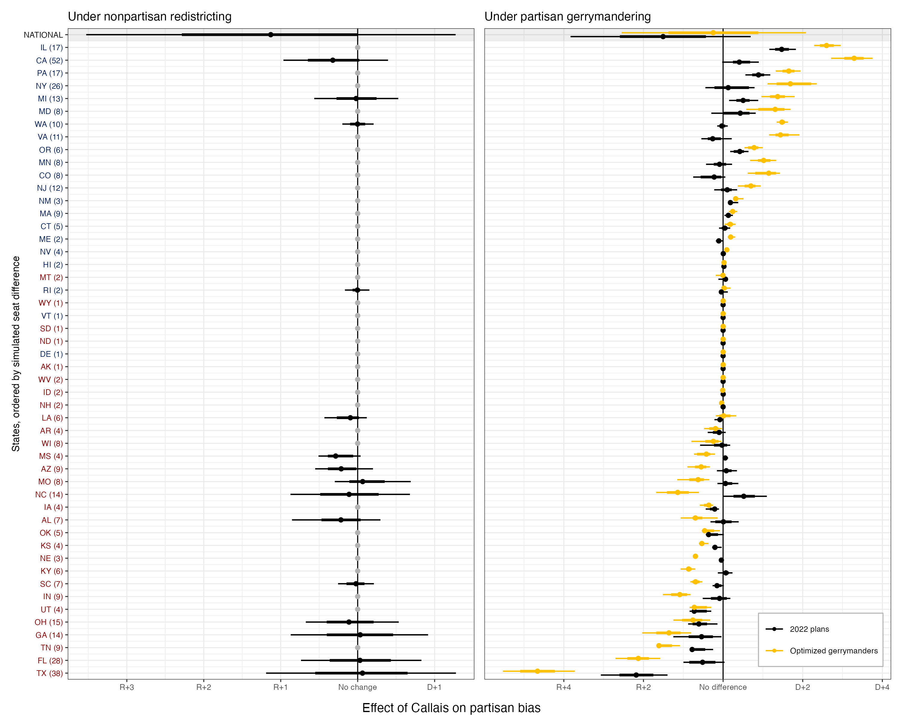

Our newest working paper studies how the Supreme Court's decision in *Louisiana v. Callais* may reshape congressional representation.
We find small partisan effects under nonpartisan redistricting, but much larger state-level effects under aggressive gerrymandering.
If both parties gerrymander aggressively, their *partisan* gains largely offset nationally.
However, the resulting maps contain about 15 fewer minority-opportunity districts and 24 fewer competitive districts.

{fig-alt="Two state-by-state plots showing small estimated partisan effects under nonpartisan redistricting and larger effects under partisan gerrymandering."}

If you're interested in reading the paper, [check it out here](https://imai.fas.harvard.edu/research/files/callais.pdf).
The full abstract is below:

> In April 2026, the U.S. Supreme Court issued the *Louisiana v. Callais* decision, weakening the Voting Rights Act (VRA). We estimate the effects of *Callais* on minority representation and electoral competition in the U.S. House under two scenarios: (1) congressional districts are drawn in a race-blind, nonpartisan manner without complying with the pre-*Callais* VRA, and (2) both parties pursue aggressive partisan gerrymandering without former VRA protections. Using state-of-the-art redistricting simulations that satisfy traditional redistricting principles and state-specific criteria, we evaluate the effects of *Callais*. We find that, in aggregate, the pre-*Callais* VRA produced aggregate levels of minority representation similar to race-blind nonpartisan redistricting, suggesting it conferred little partisan advantage. Under aggressive gerrymandering, however, *Callais* is likely to benefit Republicans while reducing minority representation, particularly in Southern states with large, geographically concentrated Black populations. It also further reduces electoral competition by 24 House seats, on average.
